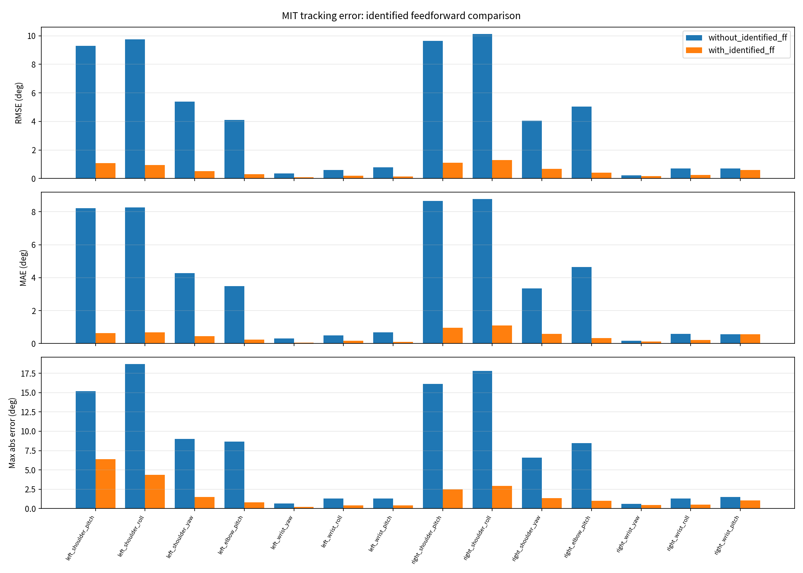

# lite_dyid 命令下发核心文档：CSP / MIT 的「丝滑」方法论与实现

> **读者**：人（上机、评审、写论文/报告）+ agent（改代码前必读）。
> **范围**：`lite_dyid` 的**发送侧**（怎么造目标、怎么按时序发出去、异常怎么收），
> 以及它**必须遵守的下游契约**（`lite_bridge` / `lite_controller` / `lite_driver`）。
> **基线**：`lite_dyid` 仓库 `main` @ `889f019`（2026-10-20）。下游代码在
> `lite_core_controller` 工作空间内，本文按**只读**引用，行号以当前工作区为准。
>
> 一句话结论：**「丝滑」不是某一个滤波器，而是"参考曲线本身连续 + 从实测姿态
> 出发 + 墙钟时基 + 200 Hz 连续出流 + 全程不碰限位/不饱和 + （MIT 下）力矩前馈
> 卸载位置环"这一整条链的结果**。任何一环破了，表面看都是"抖/顿/跟不上"。

---

## 目录

1. [链路全景与速率](#1-链路全景与速率)
2. [CSP 下发：契约、参考、时序](#2-csp-下发契约参考时序)
3. [MIT 下发：五字段、前馈、A/B](#3-mit-下发五字段前馈ab)
4. [为什么丝滑：6 条方法论](#4-为什么丝滑6-条方法论)
5. [会毁掉平滑的 8 种做法](#5-会毁掉平滑的-8-种做法)
6. [实测证据](#6-实测证据)
7. [关键参数总表](#7-关键参数总表)
8. [代码地图](#8-代码地图)
9. [失效模式速查](#9-失效模式速查)
10. [Agent 操作指南](#10-agent-操作指南)
11. [已知取舍与缺口](#11-已知取舍与缺口)

---

## 1. 链路全景与速率

### 1.1 两条通路（同一条消息，两种落点）

```
① lite_dyid（200 Hz）
     参考：解析 Fourier(q,v,a) + smoothstep 进入段
     发：  MotionCommand{mode, joint_names×14, position[, velocity, effort, kp, kd]}
        │  /lite_bridge/motion_command
        ▼
② lite_bridge（事件驱动转发）
     记账 → 授权(I1/I2) → 归一化(I4/I5) → 协议一致 → dispatchToDriver
        │  mode=0 → /csp_tracking_controller/command
        │  mode=1 → /tracking_controller/command
        ▼
③ lite_controller（100 Hz 调度）
     CSP：只写 position；锁存最后目标（命令陈旧也顶住）
     MIT：写 5 接口/关节；命令陈旧 → 全 0（passive，松劲）
        ▼
④ lite_driver（100 Hz 写帧）
     CSP：loc_ref(0x7016)        MIT：encode_mit 运控帧
        │  CAN 1 Mbit/s
        ▼
⑤ 电机固件
     CSP：loc_kp=30 → 速度环(spd_kp=5, ki=0.02) → 电流环；限幅 limit_spd / limit_cur
     MIT：τ = Kp(p_des−p) + Kd(v_des−v) + τ_ff
```

> 图中固件增益（`loc_kp=30`、`spd_kp=5`、`spd_ki=0.02`）是本机实测值，取自
> `lite_driver` 的《lite驱动MIT与CSP协议简介.md》§3.1；本项目**从不写**这些参数，
> 也就是说 **CSP 的"软硬"由固件决定，软件只能改目标、`limit_spd` 和 `limit_cur`**。

### 1.2 速率与超时（一次看清）

| 环节 | 频率 / 超时 | 说明 |
|---|---|---|
| `lite_dyid` 发布 | **200 Hz 硬上限** | `collect.py:356` 把 >200 钳到 200；理由是 1 Mbit/s CAN 在更密时会出现 `TX_QUEUE_OVERRUN` |
| 桥转发 | **事件驱动**（每条命令立即转发） | 不是按 tick 攒批，所以 200 Hz 真的到控制器 |
| 桥仲裁 tick | 100 Hz | `tick_rate_hz=100`，负责授权/超时/SAFE_HOLD |
| `controller_manager` | **100 Hz**（默认，launch 参数 `update_rate`） | 控制器的 `update()` 与驱动的 `write()` 都按它调度 |
| CAN 写帧 | 100 Hz × 每关节 1 帧 | CSP 写 `loc_ref`；MIT 写运控帧（14 帧/周期 ≈ 1400 帧/s + 反馈） |
| 源超时 | 每源 `source_timeouts_ms`（默认 500 ms） | **`MotionCommand.timeout_ms` 字段目前不被桥消费**（本包仍填 300 ms 作语义声明） |
| CSP 控制器陈旧阈值 | `stale_command_timeout_ms=100` | **只告警，不改变输出**：陈旧时继续写锁存目标 |
| MIT 控制器陈旧策略 | `passive`（默认），100 ms | 陈旧 → 写全 0（τ=0,Kp=Kd=0）= **松劲** |

> **200 Hz 发、100 Hz 收**不是浪费：控制器用 `realtime_tools::RealtimeBuffer`
> **"最新值覆盖"**，不排队。于是 200 Hz 的价值是"每个控制拍拿到的目标距理想
> 曲线 ≤ 5 ms"，而不是"电机收到 200 Hz 帧"；也不会（像 FIFO 那样）越跑越滞后。

### 1.3 CSP 与 MIT 的语义对照

| 维度 | CSP（mode 5/6/7） | MIT（mode 0/1/2） |
|---|---|---|
| 命令字段 | **只有 `position`**（其余被桥告警丢弃） | `position/velocity/effort/kp/kd` 五字段 |
| 位置语义 | **绝对目标**（写 `loc_ref`）；0 = 奔向零点 | `p_des`，与 `Kp` 相乘才有意义 |
| 力矩来源 | 电机固件内环（软件管不了） | 上位机 `τ_ff` + `Kp/Kd` 阻抗 |
| 陈旧时 | **锁存最后目标顶住**（不塌） | **passive 松劲**（会塌） |
| 收尾顺序 | 停发 → 等 1 s → HOLD → 交权 | **先 HOLD → 再停发** → 交权 |
| 能否热切协议 | 不能（驱动 `run_mode` 启动期固定，需重启 bringup） | 同左 |
| 丢包的后果 | 轻微：下一帧就是更新值，位置环仍在电机里 | 严重：命令一断就 `τ=0`，机械臂下坠 |
| 本包用途 | 300 s 大幅激励**采集**（要 80% 行程覆盖） | 120 s×2 两频**跟踪 A/B 验证**（要可比的误差） |

---

## 2. CSP 下发：契约、参考、时序

### 2.1 四条硬契约（违反了不是"效果差"，是"危险"）

来自桥/控制器的实现（读源码得到，`csp_client.py` 顶部也写了）：

1. **必须给全部 14 个关节**。桥的**不变量 I5**（`command_normalizer.hpp:252`）
   会整帧拒绝"只覆盖部分关节"的命令 —— 因为下游对每个关节都写 `loc_ref`，
   未列出的关节拿到 `0` 就是"命令它奔向零点"。
2. **`mode` 必须与驱动当前协议一致**（CSP=0）。不一致 → 整帧拒绝
   （`bridge_node.cpp:539`），桥不会偷偷切协议。
3. **`joint_names` 必须与控制器 `joints` 参数逐字同序**。控制器对
   `JointCommand` 做整帧校验，顺序不符直接丢（`csp_controllers.cpp:366`）。
4. **`position` 必须有限、长度 = 关节数**。NaN/Inf 一律拒绝。

本包的 `publish_position()`（`csp_client.py:640`）把这四条**在源头**做成
异常：长度不对、含 NaN 直接抛 `DyidError`，不发出去。

### 2.2 进入时序：任何位置命令之前

`ensure_csp_ready()`（`csp_client.py:426`）的顺序是安全关键：

```
get_status()
  ├─ protocol≠CSP ─────────────▶ 直接抛错（给出重启参数），一帧位置命令都不发
  └─ protocol=CSP
       ├─ 三个控制器都加载？否 ─▶ 抛错
       ├─ 不在 HOLD 或未 active ─▶ set_mode(HOLD) + 回读校验(ok/protocol/mode/active)
       ├─ 用当前实测姿态连发 6 帧（30 ms 间隔，约 180 ms）  ← 给源"保鲜"
       ├─ set_source{LOCK, 自己}  ← 必须在 TRACKING 之前
       └─ set_mode(TRACKING) + 回读校验 + 再独立 get_status 二次确认
```

三个细节值得记住：

- **为什么先 HOLD 再 TRACKING**：HOLD 在激活瞬间捕获实测位置，TRACKING 激活时
  也捕获实测位置 —— 两者**同姿态**。所以 6→7 的切换本身不产生任何运动，也不会
  沿用上一轮任务的旧目标。
- **为什么先发 6 帧再 LOCK**：桥对"从未发过帧的源"直接 LOCK 会按设计进
  `SAFE_HOLD`（`timeout_action=disable` 时甚至退回 MONITOR），随后的 TRACKING
  迁移守卫就失败。HOLD 期间控制器**不跟随**这些帧，所以机械臂仍然静止。
- **为什么必须 LOCK**：采集是几分钟的连续轨迹；不锁源，优先级更高且独占的源
  （如 `llm`）中途接管会让 **`cmd` 在变、`q` 不动**，`dynamics.csv` 被静默污染。
  LOCK 的语义是"只要本源自己还在发命令，就一直是它"。

### 2.3 参考从哪来：解析傅里叶 + smoothstep 进入段

`FourierTrajectory`（`trajectory.py:175`）用**闭式**位置/速度/加速度，不做查表
插值：

```
shape_j(t) = Σ_k w_k·sin(2πf·k·t + φ_{j,k}) / Σ_k w_k        (l1 归一化)
q_j(t)     = center_j + amp_j·shape_j(t)
v_j(t)     = amp_j·shapė_j(t)
q̈_j(t)     = amp_j·shapë_j(t)         ← 解析式，供辨识的加速度列使用
```

交付轨迹（`config/trajectories.yaml` / `design.py`）：

| 量 | 值 | 理由 |
|---|---|---|
| 时长 / 基频 | 300 s / **0.011 Hz** | 一个基频周期 ≈ 91 s；最高谐波 4f = 0.044 Hz |
| 谐波权重 | 1.00 / 0.35 / 0.15 / 0.05 | 低频负责大范围构型，高频只补动态信息 |
| 进入段 | **60 s**（且 ≥ `1.5·max abs(center−entry)/0.1`） | 从实测姿态走到工作点，峰值速度不超 0.1 rad/s |
| 工作点 `center` | **限位中点**（`midpoint`） | 与上电姿态无关，左右行程对称；左肩 roll 上电常贴 ±90°，用 `entry_bias` 只能走 54%，midpoint 可走 93% |
| 振幅 | `0.4·(hi−lo)` | 峰峰 = 80% 行程 |
| 覆盖校核 | **≥80%**，运行期用现场 URDF 再校 | `check()` 密采；`design.py --check` 另查 clamp 计数 |
| 速度上限 | 肩/肘 0.2、腕 0.4 rad/s（逐关节） | 惯量/额定力矩余量；实测 0.4 rad/s 已是腕部硬上限 |
| 静止段 | 每 20 s 插 6 s（15 段），末 3 s 取平均 | 静力学回归样本；**静止不消耗运动时间轴** |

两个"看起来小、其实关键"的处理：

- **`peak_normalize`**（`trajectory.py:225`）：把每关节一个基频周期内的波形按
  `(s−mid)/half` 精确映射到 `[−1,+1]`。**不做这一步**，四次谐波叠加的峰值由相位
  对齐决定，名义 80% 可能只走 50%，还会频繁触发运行期钳位。做了之后
  `amplitudes` 就是**实际半行程**，位置/速度/加速度共用同一尺度。
- **进入段公式**（`trajectory.py:350`）：
  `q = entry + s(x)·(q_f − entry)`，`v = s'(x)·(q_f − entry) + s(x)·v_f`，
  `s = x²(3−2x)`。于是 `t=0` 时 **q=实测姿态、v=0**；`t=ramp` 时**位置和速度
  都无缝接上稳态**。不需要额外规划器，也不会在 t=0 有阶跃。

### 2.4 点动 / 保持 / 回位：三种原语

`motion.py`：

| 原语 | 用法 | 关键点 |
|---|---|---|
| `move_joints` | 小幅验证、回位 | `T = 1.5·max abs(Δ) / speed_cap`，smoothstep ⇒ **两端速度为 0、峰值速度正好等于 cap**；起点默认取**当前实测** |
| `hold_position` | 静止段、验证停留 | **持续重发同一目标**，不是 `sleep`。CSP 虽然陈旧也锁存，但持续发才是"真的在保持"，也喂着桥的看门狗 |
| `RateLoop` | 所有循环的节拍器 | 绝对时钟；**落后就重锚，不追帧**（不补发积压帧） |

`RateLoop.tick()` 不追帧这一点很重要：如果落后时"连发 3 帧补上"，目标会瞬时
跳 3 步 —— 在 200 Hz 下就是一次 3 倍速的跳变。现在的做法是**放弃落后时间**，
下一拍继续从当前墙钟算 `q(t)`，所以轨迹**相位永远正确，只是采样变稀**。

### 2.5 采集主循环的时间基

`collect_trajectory()`（`collect.py:161`）用**墙钟**求值，不是帧计数：

```python
elapsed = time.monotonic() - t0
tm = t_motion + elapsed          # 运动时间轴（静止段不计入）
q, _ = traj.evaluate(tm)         # 解析求值
publish_position(q)
```

静止段：把 `q_hold = evaluate(stop)` **冻结**下发 6 s，最后 3 s 的 `q/τ` 求平均
写 `statics.csv`。运动段与静止段共用同一个 `RateLoop` 实例，但每段 `start()`
重锚一次，避免上一段的累计误差带进来。

### 2.6 最后一道保险：逐拍钳位

`_clamp()`（`trajectory.py:361`）在**每一帧**把位置钳进 `[lo, hi]`，并计数
`clamp_count`。设计期/运行前已经校核过，为什么还要逐拍钳：

> `peak_normalize` 的放大倍率是包络的函数，一旦有人手改 YAML 的
> `amplitudes/phases` 却没重跑 `--check`，构造期结论就可能与实际曲线不符。
> 真机上"越限"是硬件事故级别，逐拍 14 个 `min/max` 的代价可以忽略。

`clamp_count` 的断言位置并不统一：**MIT 验证**（`tracking_validate.py:428`）与
**离线校核**（`design.py:206`）直接要求 `clamp_count == 0`；**CSP 采集**只依赖
`check.ok`（400k 点密采校核，`collect.py:167`），没有单独断言计数 —— 见 §11 第 9 条。

### 2.7 收尾：先停发 → 回安全档 → 再交权

`finish_session()`（`csp_client.py:324`）：

```
① 停发（可选：先把目标钉在要保持在的位置，再 destroy_publisher）
② 等 settle 1.0 s（桥侧 source_timeout 500 ms / 命令 300 ms 都有余量）
③ set_mode(CSP_HOLD) —— 仅在真的进过 TRACKING 时
     ⚠️ 绝不切 CSP_MONITOR(5)：CSP 没有"松劲"，切 5 = 失能 = 自由落体
     ⚠️ 预检阶段就失败（电机从未使能）时也不切 6，否则会凭空把电机使能起来
④ set_source(AUTO) —— 把控制权干净地还回去（最后做，只影响仲裁）
```

顺序被单测钉住（`test/test_finish_session.py`），因为"先切模式再停发"会短时间
出现"旧目标还在流、控制器已经换了"的双源状态。

---

## 3. MIT 下发：五字段、前馈、A/B

### 3.1 五字段与增益

`publish_mit()`（`csp_client.py:656`）每帧发：

```
position = q_des,  velocity = v_des,  effort = τ_ff
kp = [15.0]×14,    kd = [3.0]×14        ← 14 个关节同一组增益
```

- 驱动侧只按**型号协议量程**夹取（rs-02/rs-00：`Kp≤500`、`Kd≤5`），没有更保守的
  逐关节上限。所以"给多少就编多少"，**保守值必须由上层保证**。
- 本包在 `publish_mit` 里先做范围检查（`0≤kp≤500, 0≤kd≤5`）和 NaN 检查。
- 电机侧：`τ = Kp(q_des−q) + Kd(v_des−v) + τ_ff`。

### 3.2 前馈：辨识结果怎么变成力矩

`IdentifiedFeedforward`（`tracking_validate.py:239`）：

```
τ_ff(q, v) = ĝ(q) + c1⁺(v>0) / c1⁻(v<0) + c2·v
```

- `ĝ(q)`：把辨识得到的每连杆 `[m, m·c]` **写回 pinocchio 模型**，一次
  `computeGeneralizedGravity` 求整机（`model.py:218`）。注意参数打包是
  "4 个基列"的合并，不是常见的 `[m,mx,my,mz]` 直读 —— 写错会差约 0.2 N·m。
- 摩擦：**方向相关**库仑 + 粘滞（`c1⁺/c1⁻/c2`，逐关节 3 个参数）。
- **全部离线预计算**：`precompute_feedforward()`（`:256`）一次算完整条参考的
  τ，200 Hz 实时循环里只做**查表**。这是"200 Hz 还能稳"的直接原因。
- **fail-closed**：预计算时逐关节比对额定力矩（`report.py` 的 `RATED_TORQUE`：
  肩 pitch 7、肩 roll/yaw 5、肘 5、腕 1.8 N·m），任何一拍超限就拒绝执行，
  而不是让电机去限幅。

### 3.3 参考轨迹：复用 CSP 的全套机制，只换参数

`build_validation_trajectory()`（`:191`）复用 `FourierTrajectory`：

| 量 | 值 | 理由 |
|---|---|---|
| 频率 | **0.025 Hz 与 0.05 Hz**（2 倍频） | 中频：比采集的 0.011 Hz 快，能显出跟随误差，又不触发速度上限 |
| 权重 | 1.0 / 0.35（2 次谐波） | 双频激励 |
| 振幅 | **15% 行程（半幅）→ 峰峰 30%** | 给 `Kp=15` 留出线性区，避免顶到限位/饱和 |
| 进入段 | 30 s，`approach 0.1 rad/s` | 从实测姿态到限位中点 |
| 每组时长 | 120 s（24001 点 @200 Hz） | 两频各至少 3 个 0.025 Hz 周期 |
| 校核 | 限位/速度/`clamp_count` + 2401 点 mesh 碰撞 | 跑之前就拒绝 |

A/B 两组**完全相同**的轨迹、起始姿态、`Kp/Kd`；唯一变量是 `τ_ff` 为零还是辨识
结果。两组之间用 `return_to_entry()`（`:342`）以 smoothstep 回起点：
**位置和速度都算好**，τ 也预计算并做碰撞检查，然后才逐拍回放。

### 3.4 为什么 `v_des` 必须给（而不是 0）

MIT 下 `v_des` 不是"锦上添花"：`Kd(v_des−v)` 里的 `v_des` 是**速度前馈**。
若把 `v_des` 填 0，阻尼项就变成 `−Kd·v` —— 一个**主动刹车**，会让跟随误差变大、
运动发滞。桥的归一化器专门用 `has_*` 标志而不是"0 表示未提供"，就是为了避免
这种静默语义错误（`command_normalizer.hpp:18`）。本包两路都发真实解析速度。

### 3.5 陈旧策略与收尾顺序（和 CSP **相反**）

MIT tracking 的默认策略是 `passive`：命令一陈旧就写全 0（τ=0，Kp=Kd=0）。
所以**不能照抄 CSP 的收尾顺序**：

```
MIT：① 先发一帧"钉住姿态"的 MIT 命令（可选）→ set_mode(MIT_HOLD)
     ② 再停发
     ③ set_source(AUTO)
CSP：① 先停发 → ② 等 1 s → ③ set_mode(CSP_HOLD) → ④ set_source(AUTO)
```

`finish_mit_session()`（`csp_client.py:388`）的注释写得很直白：MIT 若像 CSP
那样"先停发再等"，机械臂会在 HOLD 接管前**失去阻抗力矩**。

同理，`settle_at_entry()`（`:331`）是**持续发** 2 s（不是 `sleep`），而 CSP 的
`return_home()`（`collect.py:268`）可以在最后 `sleep` 1–5 s 再补一帧 —— 因为
CSP 在电机里锁存，MIT 不在。

### 3.6 协议不能热切：URDF 语义摘要

辨识在 CSP 下采集，跟踪验证必须在 MIT 下跑；而 xacro 会把
`ros2_control/hardware/param[@name='control_mode']` 从 `csp` 改成 `mit`。
`check_live_urdf_compatible()`（`:159`）的做法是：

1. 先比完整 XML 语义摘要（标签/属性/文本/子树）；
2. 不等则**只忽略**该 `control_mode` 参数再比一次；
3. 仍不等 → 拒绝（关节、限位、传动、惯性、几何任何变化都不许套用旧参数）。

这既允许"同一机械模型、不同通信协议"，又不会把"换了机型还沿用旧参数"放过去。
若当前是 CSP，`ensure_mit_ready()`（`csp_client.py:534`）只做三件事：切
`CSP_MONITOR` 使电机失能、尽力解除源锁（`set_source{AUTO}`）、抛
`ProtocolRestartRequired` 给出重启命令 —— **绝不假装切成功，也绝不发 MIT 帧**。

---

## 4. 为什么丝滑：6 条方法论

### P1 参考曲线本身连续，而且低频

解析傅里叶 ⇒ 位置/速度/加速度都是闭式、有界；CSP 采集最高成分 0.044 Hz，
MIT 验证最高 0.05 Hz。**低频 + 有限幅值**意味着 jerk 天然很小，控制器的
速度/加速度余量充足。

### P2 边界条件对齐：从实测姿态出发，两端零速

- 进入段：`q(0)=entry`、`v(0)=0`；`q(ramp)=稳态`、`v(ramp)=稳态`（C¹ 无缝）。
- 点动/回位：smoothstep 两端速度为 0，峰值速度 = 设定 cap。
- 于是**没有阶跃目标**，也就没有"位置环被一步大偏差打满力矩"的瞬态。

### P3 墙钟时基 + 不追帧

`evaluate(t_monotonic)` 而不是"帧号 × 周期"。调度抖动只让**采样变稀**，不会
让**相位漂移**，更不会补发积压帧。抖动的后果被限制在"这一拍的目标新鲜度"，
而不是"速度忽快忽慢"。

### P4 指令流连续，且接收端语义配合

- CSP：200 Hz 连续发 + 控制器**锁存** ⇒ 丢一两帧不产生台阶，也不会塌。
- MIT：200 Hz 连续发 + **预计算表** ⇒ 每拍只做查表/发布，不会因为重算模型
  掉到 100 Hz；`stale` 是 passive，所以"不断流"本身就是安全要求。
- 桥侧 `RealtimeBuffer`（最新值覆盖）⇒ 不积压、延迟不随时间增长。

### P5 几何/力矩预算充足，永远不进入"救场"状态

速度上限（0.2/0.4）、进入段限速（0.1）、限位 inset（振幅 + 0.10 rad）、
逐拍 clamp、6001 点 mesh 预检、MIT 前馈额定力矩 fail-closed —— 这些让系统
**在正常范围内永远不触发限幅/饱和/急停**。限幅和饱和是"顿挫"最常见的来源。

### P6（MIT 专属）前馈把位置环"卸下来"

`τ_ff` 承担重力+摩擦后，`Kp=15/Kd=3` 只需要修正残差，位置环始终在小误差的
线性区；没有前馈时，同样的 `Kp` 要硬扛几 N·m 的重力偏差，误差大、饱和风险高、
跟随明显滞后。实测 RMSE 从 4.34° 降到 0.55°（见 §6）。

> 换个角度总结：**P1/P2 决定"参考长什么样"，P3/P4 决定"发得像不像参考"，
> P5 决定"会不会被保护逻辑打断"，P6 决定"执行器跟不跟得上"。四层都成立才叫丝滑。**

---

## 5. 会毁掉平滑的 8 种做法

| # | 反例 | 后果 | 本包怎么防 |
|---|---|---|---|
| 1 | 直接给阶跃目标 / 不做进入段 | 位置环被大偏差打满力矩，起步"弹一下" | smoothstep 进入段，t=0 用实测姿态 |
| 2 | 用帧号算相位 | 调度抖动变成速度波动，长跑后相位漂移 | 墙钟 `monotonic()` 求值 |
| 3 | 落后时补发积压帧 | 瞬时 2–3 倍速跳变 | `RateLoop` 落后重锚，不追帧 |
| 4 | 每帧重算 pinocchio 回归 | 200 Hz 掉到 100 Hz 以下，MIT 直接 passive | MIT 前馈全离线预计算，实时只查表 |
| 5 | MIT 只发 position，`v_des=0` | `−Kd·v` 变成主动刹车，跟随发滞 | 两路都发解析速度 |
| 6 | 命令停发 / 断流 | CSP：桥超时 SAFE_HOLD；MIT：松劲下坠 | 200 Hz 连续出流；收尾顺序按协议区分 |
| 7 | 越限后靠驱动钳位 | 目标被截断 ⇒ 速度突变 + 位置环顶死 | 设计期 inset + 运行期逐拍 clamp + `dyid_design --check` 的 clamp 检查 |
| 8 | 发布频率 >200 Hz | `TX_QUEUE_OVERRUN`、丢帧、桥判陈旧 | `collect.py:356` 硬上限 200 |

---

## 6. 实测证据

### 6.1 MIT A/B（同一台机器、同一轨迹、同一 `Kp/Kd`）

运行：`/tmp/dyid_runs/run_20261019_234605/tracking_validation_20261020_001906/`
（辨识 LPF=0.2、`static_friction_only`、200 Hz）

| 指标 | 无辨识前馈 | 有辨识前馈 | 变化 |
|---|---|---|---|
| 14 关节平均 RMSE | **4.338°** | **0.553°** | **−74.7%** |
| 最好关节（左肘） | 4.099° | 0.291° | −92.9% |
| 改善最小（右腕 pitch） | 0.694° | 0.596° | −14.0%（振幅本身很小） |
| 逐关节最大误差 | 15.2–18.7°（肩） | 2.5–6.4°（肩） | — |



*（图：14 关节的 RMSE / MAE / Max abs error，两组条件同轨迹同增益。生成自
`tracking_error_comparison.png`。）*

### 6.2 下发节拍（同一次运行，从 CSV 的 `wall_t` 反算）

| 条件 | 样本 | 实际频率 | `Δt` 均值 | `Δt` 标准差 | `Δt` p99 | 最大 |
|---|---|---|---|---|---|---|
| 无前馈 | 24001 | **200.0 Hz** | 5.000 ms | **0.108 ms** | 5.268 ms | 7.302 ms |
| 有前馈 | 24001 | **200.0 Hz** | 5.000 ms | **0.102 ms** | 5.236 ms | 6.333 ms |

**标准差 ~0.1 ms、p99 ~5.24 ms**：时间轴几乎没有抖动。这是 P3 的直接证据。

### 6.3 CSP 辨识质量（同一次采集）

| 量 | 值 |
|---|---|
| 重力回归拟合 RMS（14 关节均值） | **0.141 N·m** |
| 摩擦拟合 RMS（14 关节均值） | **0.123 N·m** |
| 重力参数数值秩 / 条件数 | **28 / ∞**（72 个参数里只有 28 个独立组合 —— 见 README §6） |
| 采集样本 | 300 s @200 Hz（≈6 万行）+ 15 段静止 |

> 重力/摩擦的残差量级 ≈0.1 N·m，恰好说明"为什么 MIT 前馈能降 4.34°→0.55°"：
> 前馈补掉的是**几 N·m 量级的重力与摩擦**，残差只剩 0.1 N·m 级。

---

## 7. 关键参数总表

### 7.1 CSP 采集（`config/dyid.yaml` + `trajectories.yaml`）

| 参数 | 值 | 位置 |
|---|---|---|
| `publish_rate_hz` | 200（硬上限） | `dyid.yaml` / `collect.py:356` |
| `command_timeout_ms` | 300 | `dyid.yaml` |
| `speed_cap` / `return_speed` | 0.15 / 0.12 rad/s | `dyid.yaml` |
| 逐关节速度上限 | 肩/肘 0.2，腕 0.4 | `common.py:30` |
| 小幅验证 | ≤0.15 rad（8.6°，走余量大的一侧）、0.10 rad/s、停 1.5 s、实动≥50%、误差≤0.25 rad | `dyid.yaml` |
| 轨迹 | 300 s、0.011 Hz、1–4 次谐波、60 s 进入、80% 覆盖、峰值≥0.05 rad/s | `trajectories.yaml` |
| 工作点 | 限位中点 | `trajectories.yaml` |
| 限位余量 | 0.10 rad | `trajectory.py:43` |
| 静止段 | 15 × 6 s（每 20 s），末 3 s 平均 | `trajectories.yaml` |
| 碰撞采样 | 6001 个位形 | `dyid.yaml` |
| 求解前低通 | 0.2 Hz 零相位（**只影响辨识，不影响下发**） | `dyid.yaml` |

### 7.2 MIT 验证（`tracking_validate.py` 常量）

| 参数 | 值 |
|---|---|
| 频率 / 谐波 | 0.025 Hz / 0.05 Hz，权重 1.0 / 0.35 |
| 振幅 | 15% 行程（半幅），峰峰 30% |
| 进入段 / 每组时长 | 30 s / 120 s |
| 增益 | `Kp=15`、`Kd=3`（14 关节相同） |
| 回位速度 / 稳定 | 0.10 rad/s / 2 s（持续发） |
| 下发频率 | 200 Hz（`--rate-hz` 上限 200） |
| 前馈上限 | 逐关节额定力矩（7/5/5/1.8 N·m），超限拒绝执行 |
| 输出 | `~/.ros/lite_dyid/tracking_validations/<run>/tracking_validation_<ts>/` + `artifacts.json` |

---

## 8. 代码地图

### 8.1 本包（`src/lite_dyid/`）

| 文件 | 职责 | 关键符号 |
|---|---|---|
| `lite_dyid/common.py` | 关节顺序、镜像符号、速度上限、话题/服务、模式常量 | `ARM_JOINTS` `MIRROR_SIGN` `velocity_cap_of` |
| `lite_dyid/csp_client.py` | **唯一出口**：状态、模式、锁源、命令、收尾 | `ensure_csp_ready:426` `ensure_mit_ready:534` `publish_position:640` `publish_mit:656` `finish_session:324` `finish_mit_session:388` |
| `lite_dyid/motion.py` | 原语：smoothstep 移动、保持、节拍器 | `move_joints:73` `hold_position:121` `RateLoop:44` |
| `lite_dyid/trajectory.py` | 傅里叶参考、进入段、限位、校核、逐拍钳位 | `FourierTrajectory:175` `evaluate:333` `_clamp:361` `check:385` |
| `lite_dyid/collect.py` | 主流程：预检→小幅→采集→解算→收尾 | `small_check:110` `collect_trajectory:161` `return_home:268` `main:336` |
| `lite_dyid/tracking_validate.py` | MIT A/B：URDF 摘要、前馈、回放、产物 | `build_validation_trajectory:191` `precompute_feedforward:256` `run_trial:287` `return_to_entry:342` |
| `lite_dyid/model.py` | URDF→pinocchio、重力回归基、碰撞 | `fast_gravity_evaluator:218` `collisions:277` |
| `lite_dyid/identify.py` | 重力/摩擦辨识、`params.json` schema 2 | `identify_fast` `load_params` `save_params` |
| `lite_dyid/limits_table.py` | 离线限位副本（设计与校核用） | `SIM_LIMITS:42` |
| `lite_dyid/report.py` | 图与统计、额定力矩表 | `RATED_TORQUE:17` `tracking_error_stats:133` |
| `test/` | 离线单测（78 项，不需真机） | `test_csp_startup` `test_finish_session` `test_mit_validation` |

### 8.2 下游契约（只读，改动需另行评审）

| 文件:行 | 作用 | 对本包的含义 |
|---|---|---|
| `lite_bridge/include/lite_bridge/command_normalizer.hpp:146` | 归一化；第 ④ 步强制全覆盖（I5） | 每帧必须给全 14 关节 |
| `lite_bridge/src/bridge_node.cpp:481` | `onMotionCommand`：未知源/未授权/NaN/协议不符 → 丢弃 | `source` 必须在 `source_names` 里；`mode` 必须匹配 |
| `lite_bridge/src/bridge_node.cpp:681` | `dispatchToDriver`：按协议选话题，五数组全填 | CSP 下 `velocity/effort/kp/kd` 会被忽略但仍需长度合法 |
| `lite_controller/src/csp_controllers.cpp:387` | CSP 跟踪：新鲜→锁存并写；陈旧→**继续写锁存值** | 丢帧不会让 CSP 塌；切 5 才会 |
| `lite_controller/src/tracking_controller.cpp:226` | MIT 跟踪：陈旧→passive 全 0 | **不能先停发**；必须保持出流 |
| `lite_controller/src/hold_controller.cpp:425` | MIT HOLD：位置与增益**同步**斜坡（0.5 s） | 进 HOLD 不跳变的原因 |
| `lite_driver/src/lite_driver_system.cpp:1598` | 每拍写 loc_ref / MIT 运控帧 | 100 Hz 控制周期 |
| `lite_driver/src/lite_driver_system.cpp:808` | CSP 进入：`limit_spd`、`acc_rad`、`limit_cur` | 速度/电流上限由 URDF 配 |
| `lite_driver/include/lite_driver/protocol.hpp:241` | 定点缩放 + 饱和钳位 | 越界值在这里被硬钳（所以不能越界） |

---

## 9. 失效模式速查

| 现象 | 最可能原因 | 检查点 |
|---|---|---|
| CSP 完全不发/不动 | 协议不是 CSP、`source` 未授权、模式不是 7 | `get_status` 的 `protocol/mode/active_controller`；日志 `丢弃未知数据源` / `命令被拒绝` |
| 动一下就停 | 桥超时（源停止出流）、`/safety_status` FAULT | 200 Hz 是否真在发；`ros2 topic hz /lite_bridge/motion_command`；`clear_fault` |
| 某关节"奔向零点" | 该关节未被命令覆盖（I5 兜底被绕过）或 position 含 0 | 确认 `joint_names` 14 个；看桥日志 `只覆盖 x/14` |
| 起步/收尾"弹一下" | 没有进入段、或切换时目标不是实测姿态 | `evaluate(0)==entry`；`ensure_csp_ready` 是否先 HOLD |
| 运动中偶发"顿一下" | 补发积压帧 / 每拍重算模型 / CAN 丢帧 | 看发布频率与 `Δt` 分布、`rejected_commands`；MIT 另看 `lag_max` |
| MIT 松劲下坠 | 命令断流（passive）或误用 CSP 收尾顺序 | 是否持续 200 Hz 出流；`finish_mit_session` |
| MIT 跟随明显滞后 | 没给 `v_des`，或前馈没生效 | `tau_ff` 是否非零；`velocity` 是否发了真实速度 |
| 误差整体偏大 | 采集时被抢占（未 LOCK）、URDF 换了 | `set_source{LOCK}` 回读；URDF 语义摘要 |
| `clamp_count>0` | YAML 改过但没重跑 `--check` | `dyid_design --check`，重跑校核 |
| 桥反复报 "关节列表不符" | 控制器 `joints` 与 canonical 漂移（16 vs 14） | `controllers_csp.yaml` 不应硬编码 `joints` |

---

## 10. Agent 操作指南

### 10.1 五条铁律（改这个包之前）

1. **不要在 `~200 Hz` 的循环里做重活**（pinocchio、numpy 大矩阵、文件 I/O）。
   参考和力矩都应在循环外算好，循环里只求值/查表/发布。
2. **不要用帧号当时钟**。所有 `q(t)` 用 `time.monotonic()` 的 `elapsed`。
3. **不要改收尾顺序**：CSP = 停发→等→HOLD→交权；MIT = HOLD→停发→交权。
   单测 `test_finish_session.py` 会挡住 CSP 侧；MIT 侧没有单测，靠 review。
4. **不要绕过 I5 / 关节顺序 / NaN 检查**。它们是"安全不变量"，不是风格。
5. **不要跨协议热切**。检测到协议不符就抛 `ProtocolRestartRequired`，让操作员
   重启 bringup；任何"偷偷切"的实现都会被桥拒绝，且让人误判。

### 10.2 常用命令

```bash
# 单测（不需真机）
cd src/lite_dyid && /usr/bin/python3 -m pytest test -q

# 轨迹离线校核（不碰机器人）
ros2 run lite_dyid dyid_design --generate /tmp/trajectories.yaml
ros2 run lite_dyid dyid_design --check --urdf /tmp/lite_arms.urdf

# CSP 采集（先起 CSP bringup，见 RUNBOOK §1.3）
ros2 run lite_dyid dyid_collect --output-dir /tmp/dyid_runs

# MIT A/B（先按提示重启成 MIT bringup）
ros2 run lite_dyid dyid_tracking_validate --run-dir /tmp/dyid_runs/run_xxx
```

### 10.3 改动后的验收清单

- [ ] `pytest test -q` 全绿（当前 78 项）。
- [ ] 改动涉及轨迹时：`dyid_design --check` 通过，`clamp_count == 0`。
- [ ] 改动涉及前馈时：峰值力矩不超过逐关节额定，`precompute_feedforward` 不抛错。
- [ ] 改动涉及发布循环时：`ros2 topic hz /lite_bridge/motion_command` ≈200 Hz，
      且 `Δt` p99 不显著超过 5.3 ms。
- [ ] 改动涉及模式/收尾时：单测 + 真机先跑 `--small-check-only`。
- [ ] MIT 改动：确认 `v_des` 仍是解析速度、`kp/kd` 未越界、URDF 摘要仍兼容。

---

## 11. 已知取舍与缺口

> 这一节是**写给未来的自己/agent** 的：下面都是"知道但暂不改"或"文档超前于
> 实现"的地方，不要当成 bug 重新发现一遍。

1. **CSP 采集没有 `/joint_states` 陈旧看门狗**（README §10 声称断流会立即中止，
   实际只有 MIT 的 `run_trial` 有 0.25 s 检查，`tracking_validate.py:303`）。
   CSP 的 `collect_trajectory` 只查 `/safety_status`。后果：采集期 `/joint_states`
   断流会把**同一帧实测值**反复写入 CSV，`cmd` 仍在变 —— 数据静默失真。
   若要补：在运动段每拍加 `if snap.age() > 0.1: raise DyidError`。
2. **静止段入口是"目标冻结"而非"减速到零再停"**：运动段在 `t=stop` 处仍有
   非零速度（轨迹与 20 s 网格不对齐），目标位置冻结 ⇒ 一次速度台阶，由固件
   位置环吸收。这是为静力学取样付出的代价（保持运动时间轴不变）。
3. **`smoothstep` 是 C¹ 不是 C²**：两端速度为 0，但加速度在端点有有限阶跃
   （`6Δ/T²`）。在 0.1–0.15 rad/s 的量级下可接受；若将来提速，应换
   minimum-jerk 或五次多项式。
4. **200 Hz 发布 / 100 Hz 控制周期**：无害（最新值覆盖），但"实际执行频率"
   是 100 Hz；写文档/报告时不要说"电机以 200 Hz 执行"。
5. **`MotionCommand.timeout_ms` 未被桥消费**：仲裁用的是每个源的
   `source_timeouts_ms`（默认 500 ms）。本包填 300 ms 只是语义声明。
6. **`--workers>1` 用 `os.fork`**：在 ROS 节点内可能遇到 fork 相关异常，
   `collect.py` 的注释已给出回退方案（`--workers 1`）。
7. **本次修复**：`test_mit_validation.py` 缺 `from pathlib import Path`，导致
   3 个新用例 NameError 未真正跑通；已在 `889f019` 补上（78 项全绿）。
8. **`params.json` 的 `I` 全 0**：`static_friction_only` 时惯量没有辨识，
   下游不能据此算 `M(q)`（`usable_for_mass_matrix=false`，fail-closed）。
9. **README §4 的 `clamp_count == 0` 说得比实现强**：CSP 采集侧只看密采校核
   `check.ok`，只有 MIT 验证和 `dyid_design --check` 真的断言了
   `clamp_count == 0`。想收紧就在 `collect_trajectory` 里加
   `assert traj.clamp_count == 0`（要在整条轨迹跑完之后判）。

---

## 附：一页纸回顾

```
目标怎么来的：  解析傅里叶（低频、有限幅值）+ smoothstep 进入段（从实测姿态、两端零速）
                + 限位中点工作点 + peak_normalize（80% 精确覆盖）+ 逐拍 clamp
怎么发出去的：  monotonic 墙钟求 q(t)，200 Hz 连续发，落后重锚不追帧；
                每帧全 14 关节、mode 与协议一致、NaN/长度在源头就拒绝
CSP 怎么接：    桥 I5 校验 → csp_tracking 锁存 → 100 Hz 写 loc_ref → 固件 loc_kp/spd 环
                （陈旧=顶住；切 5 才是松劲）
MIT 怎么接：    五字段 → tracking 控制器 → 100 Hz 运控帧 → τ=Kp·Δp+Kd·Δv+τ_ff
                （陈旧=松劲；前馈=重力+方向摩擦，离线预计算，超额定拒绝执行）
为什么丝滑：    参考连续 + 边界对齐 + 时基一致 + 不断流 + 不饱和 + 前馈卸载
实测：          200.0 Hz，Δt std 0.10 ms；MIT RMSE 4.338° → 0.553°（−74.7%）
```
